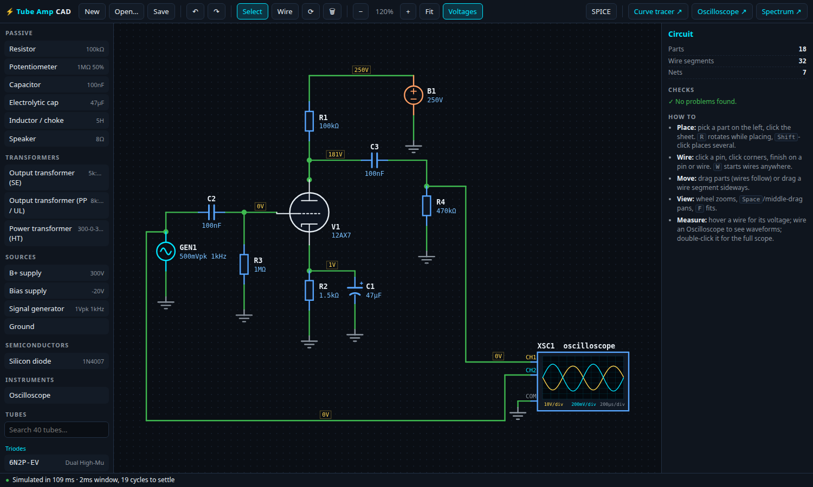
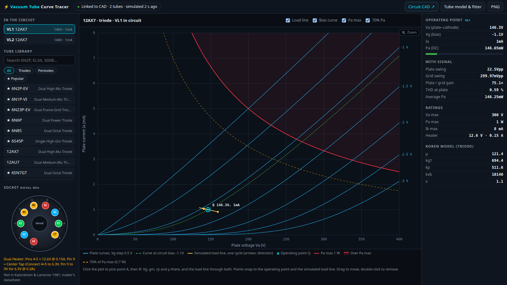
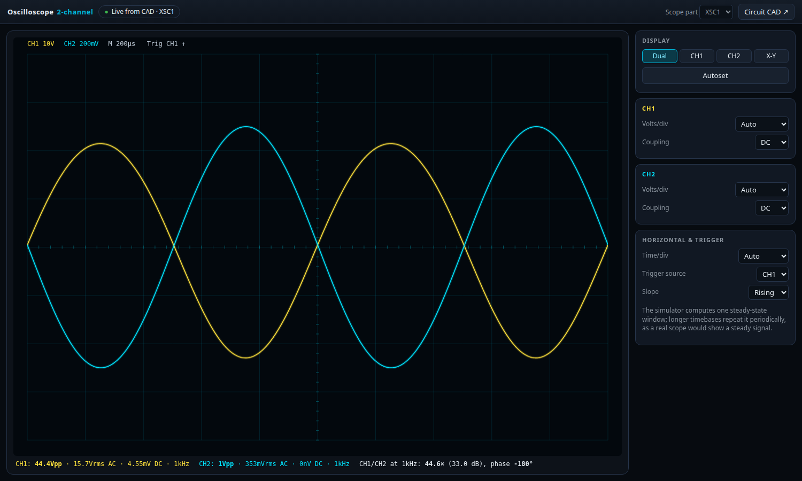
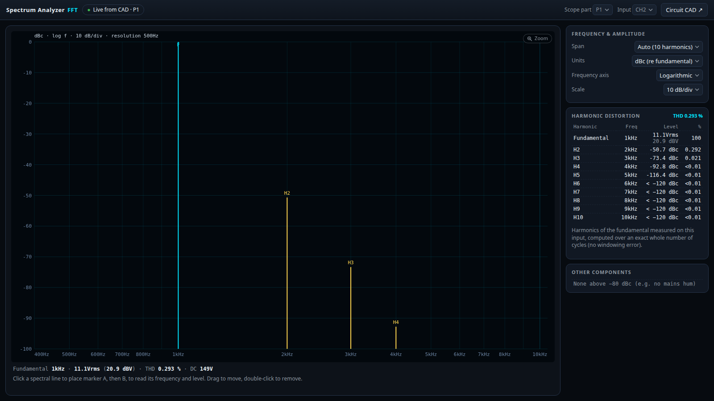
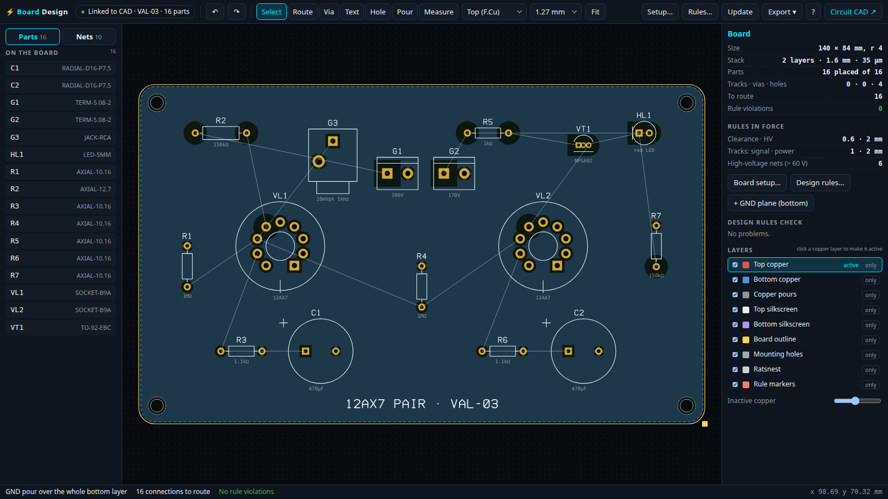
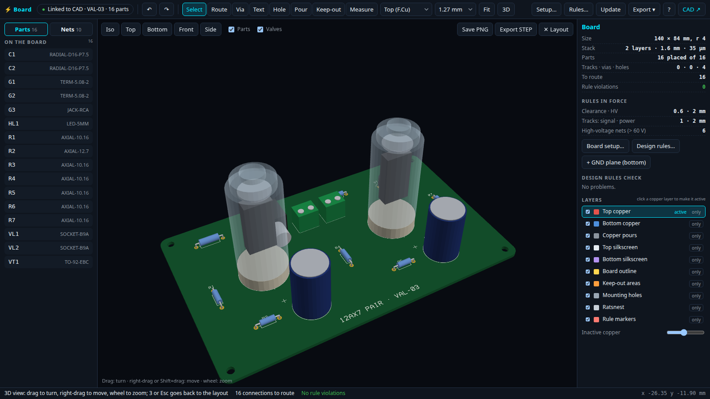

# Tube Amp CAD

Design and simulate vacuum-tube amplifiers in the browser. You draw a
schematic, and a circuit simulator computes the operating points and
waveforms. A curve tracer, an oscilloscope, a spectrum analyzer and a Bode plotter show
the result as bench instruments would.

**Live:** [kothf.github.io/tube-amp-cad](https://kothf.github.io/tube-amp-cad/) ·
also on [aerocat.tech/tools](https://aerocat.tech/tools/)



There's nothing to install, no account and no server. Everything runs on
your machine, and the browser saves your circuit.

**Browsers:** tested in Chrome, Edge and other Chromium browsers (Brave,
Vivaldi, Opera) and in Safari (the whole test suite also runs in WebKit).
Firefox is not tested.

## Contents

- [The schematic editor](#the-schematic-editor)
- [Parts](#parts)
- [Measuring on the schematic](#measuring-on-the-schematic)
- [Drawings, documents and exports](#drawings-documents-and-exports)
- [Instruments](#instruments)
- [Board Design](#board-design)
- [Keyboard shortcuts](#keyboard-shortcuts)
- [How the simulator works](#how-the-simulator-works)
- [Accuracy](#accuracy)
- [Run it locally](#run-it-locally) · [Development](#development) · [Contributing](#contributing)

## The schematic editor

- **Placing parts.** Pick a part in the palette on the left and click the
  sheet; Shift-click places several. The search box at the top of the palette
  finds:
  - parts by name;
  - part numbers: 2N3904, IRF540, 1N4742A, 125ESE, 373BX …;
  - tubes: EL84, 6N2P, 300B …;
  - values: `47k` offers a 47 kΩ resistor or potentiometer, `100n` a
    100 nF capacitor, `47u` an electrolytic, `5H` a choke, `300V` a supply.

  Enter picks the first match. Click a palette group's title to fold it; the
  browser remembers which groups are open.
- **Wiring.** Click a pin, click the corners, and finish on a pin or a wire.
  <kbd>W</kbd> starts a wire anywhere. A wire ending on another wire joins it
  with a junction dot; plain crossings stay unconnected.
- **Editing.**
  - Drag parts and their wires follow; drag a wire segment sideways to move
    it.
  - <kbd>Space</kbd> rotates (also while placing or dragging a part; <kbd>R</kbd>
    works too), <kbd>M</kbd> mirrors left to right, <kbd>D</kbd>
    duplicates, <kbd>Del</kbd> deletes, with undo and redo.
  - Mirror works for every part that can rotate, including any part added to
    the library later. So a complementary pair, or a tube taking its grid from
    the right, can be drawn without crossing wires. The oscilloscope mirrors
    too, so its inputs can come in from the right; its screen stays upright.
- **Inspector (right).** Every value of the selected part: resistance
  ("4.7k"), tube type, transformer model and tap, generator level in Vpk, Vrms
  or dBV. With a simulation result it adds:
  - the part's operating point: Va, Vg, Ia, Pa and gain for a tube; Vce, Ic,
    hFE and dissipation for a transistor;
  - checks against the part's ratings.

  With nothing selected it shows a power summary instead: output into the
  speakers, and tube, transistor and resistor dissipation.
- **Live or on demand.** The circuit re-simulates after every edit, or turn
  *Live* off and press *▶ Simulate* (<kbd>Ctrl</kbd>+<kbd>Enter</kbd>).
  - Either way, slow power supplies are run until they have fully settled.
  - The button shows the run's progress ("■ Stop · 48 %"); press it again to
    stop a long run.
  - When a steady-state run and the oscilloscope's power-on transient run at
    once, the status line shows both on one line with one progress bar.
- **Checks.** Unconnected pins, shorted parts, a missing ground, sheet
  connectors without a partner, and parts beyond their ratings: resistor
  power, output-transformer DC current, transistor Vce and dissipation, zener
  power, and for tubes:
  - anode dissipation (Pa) and screen dissipation (Pg2), averaged over the
    signal cycle; screen voltage; cathode current;
  - heater-to-cathode voltage at its worst instant, against the rating for
    that direction (a rectifier's or a raised cathode's "heater negative"
    rating is often higher). The heater is taken as grounded; set *Heater DC
    potential* on the tube for an elevated heater supply;
  - the grid circuit resistance (grid stopper, grid leak, volume pot) against
    the largest the tube allows with cathode or with fixed bias, where too
    much lets the tube run away as it warms;
  - a rectifier's rectified current and peak inverse voltage.

  The tube's inspector shows each of them as a share of its rating. Ratings
  come from Katsnelson & Larionov for the Soviet tubes and from the makers'
  datasheets for the others (RCA, Philips, Mullard, Western Electric); a
  rating a datasheet does not give is not checked.
- **Toolbar.** One row: the *Schematic | Board* switch (the same switch in the Board window leads back; Alt+B and Alt+S from any window; *Windows ▾ → Board in this window* makes the board a tab of the CAD window instead of a window of its own), *File ▾*, *View ▾* (the Voltages, Currents and Legend on the schematic, and the bill of materials, Checks and Tolerance tabs under it, ticked on or off), *Edit ▾* (undo, redo, rotate, mirror, duplicate, delete, copy, paste, select all, renumber), undo / redo, the *Select | Wire | Probe* tool, zoom and *Fit*, *● Live | ▶ Simulate*, and *Windows ▾* (oscilloscope, spectrum analyzer, Bode plotter, curve tracer, board layout and the manual). The right mouse button on a part or wire opens the editing commands there. At 900 px and below the inspector is a drawer that slides in when something is selected (*Inspector* button).
- **Hints and manual.** Every field, readout, instrument setting and model coefficient explains itself when you rest the pointer on it (labels with a dotted underline). The manual, `help.html`, opens from *Windows ▾ → Manual*, the help dialog, or **?** in each instrument. It covers:
  - a quick start, then every part and field;
  - all 99 tubes in a sortable table;
  - every readout and the checks;
  - the instruments and the board layout;
  - a design cookbook, and the simulator's equations and limits.

  It is searchable.
- **Layout.**
  - Drag the edge of the palette, the inspector or the BOM to resize it, and
    double-click the edge to reset it. The same goes for the side panels of
    the instrument windows.
  - <kbd>F1</kbd> or the **?** button opens the help with every shortcut and a link to the manual.
  - Shortcuts go by the key's position, so they work with a Russian or any
    other keyboard layout.
- **Files.**
  - File → Open / Save / Save as (JSON). In Chrome and Edge, Save writes back
    to the opened file after asking; in Safari and other browsers it
    downloads the file.
  - The circuit is also autosaved in the browser.
  - The open file's name shows in the toolbar and the browser tab's title; a
    yellow • marks unsaved changes (the board's too). A circuit not saved to
    a file yet (a new one, or an example) shows its title block's title (or
    its identification number) in grey italics, such as "NE555 metronome:
    astable into a speaker"; "Untitled" only when the title block is empty.

## Parts

| Group | Parts |
|---|---|
| Passive | resistor (with power rating, marked in the symbol per ГОСТ 2.728), potentiometer (lin/log), capacitor, electrolytic, choke with DCR, speaker: an ideal resistor, or a **loudspeaker** from its Thiele–Small parameters (Re, Le, fs, Qms, Qes; typical guitar and hi-fi drivers to start from) with its impedance and phase curve in the inspector; **protection**: fuse (5 × 20, 6.3 × 32, TR5; Checks from 75 % of its rating), inrush limiter NTC (Ametherm SL series, simulated at its self-heated resistance), varistor (TDK SIOV); capacitors take a voltage rating that Checks watches; **headphone loads** 32, 250, 300 and 600 Ω with their resonance peaks |
| Switches & relays | changeover switch, on–off toggle, push buttons (normally open / closed), rotary selector (2–12 ways), all ganged by section names; **relays** Omron G5LE-1 (SPDT) and G5V-2 (DPDT) with 5 / 12 / 24 V coils (coil resistance and inductance, must-operate and release, timing checked against ngspice); **vactrols** VTL5C3 and VTL5C1 (the cell following the LED's current, with the datasheet's turn-on and turn-off times) |
| Transformers | generic single-ended and push-pull/UL output transformers and a generic power transformer; **interstage and input transformers** (turns ratio, optional centre-tapped secondary, primary and leakage inductance, winding capacitance, DCRs, the DC the core is gapped for; typical interstage, microphone, moving-coil and line presets), checked against ngspice's coupled inductors; the seven **Hammond 125SE** output transformers and 25 **Hammond 300-series** power transformers, modelled from the maker's drawings (winding resistances, inductance, excitation, no-load voltages, ratings) |
| Tubes | every tube's anode temperature from its dissipation, glowing red when over-driven (red-plating); **110 tubes**: the Soviet receiving tubes from Katsnelson & Larionov, «Отечественные приёмно-усилительные лампы и их зарубежные аналоги» (1981), including triodes and double triodes (6С2С, 6С33С, 6Н1П…6Н33Б), voltage and output pentodes (6Ж1П, 6Ж32П, 6П1П, 6П3С, 6П14П, 6П27С…), triode-pentodes as two sections (6Ф1П, 6Ф3П, 6Ф4П, 6Ф5П) and kenotrons (5Ц3С, 5Ц4С, 6Ц4П…), with the handbook's ratings and pinouts; plus Western tubes from their makers' datasheets (12AX7, 12BH7A, 6CG7, EL84, 6AQ5A, ECL82, EL34, KT66, KT88, 6AS7G, 300B, 211, 845, GZ34, 5Y3GT, EZ81, 6X4…). Pentodes can be used triode-connected. **Import SPICE model…** adds any tube model of your own (see below). |
| Semiconductors | **diodes**: standard rectifiers 1N4001/1N4004/1N4007, 1N5404/1N5408, fast and ultrafast UF4007, UF5408, MUR160, MUR460, HER108, FR107, Schottky BAT85, 1N5817, 1N5819, 1N5822, SB1100, SiC Schottky C3D02060A, C3D04060A, C4D02120A, the 1N4148, with reverse recovery; **bridge rectifiers** DF04M, DF10M, W04G, W10G, B250C2300-1500A, GBU4J, GBU8K, KBU8K, KBPC2510, KBPC3510; zener diodes, the 1 W 1N4728A … 1N4764A series and 5 W 1N5349B … 1N5388B (3.3–200 V); LEDs (red, yellow, green, blue) for cathode bias; **NPN** 2N2222A, 2N3904, BC107, BC547B, BD139, MPSA42, MJE340 and **PNP** 2N2907A, 2N3906, BC177, BC557B, BD140, MPSA92, MJE350; **drivers and power output** in complementary pairs: 2SD669A/2SB649A, 2SC4793/2SA1837, MJE15032/MJE15033, TIP41C/TIP42C, 2SC5200/2SA1943, MJL3281A/MJL1302A, MJL21194/MJL21193, and in TO-3 (on wires, for a chassis heatsink) MJ15003/MJ15004, MJ15024/MJ15025, 2N3055/MJ2955; **germanium** (VBE about 0.2 V, low fT): USSR MP39B, MP40A, MP41A, MP42B, MP25B, MP26B, MP38A (NPN), GT402G/GT404G, P213B (МП39Б … П213Б) and Western AC127/AC128, AC187/AC188, OC71, NKT275, 2N404, AD149, AD161/AD162, with their collector leakage (ICBO, doubling every 10 °C); every bipolar transistor has a **Temperature** (VBE −2 mV/°C, hFE and leakage rising); **N-MOSFETs** 2N7000, BS170, IRF510, IRF540, IRF820, IRF840, IRFP240, IRFP250, IRFP460, the laterals 2SK1058 and ECX10N20, and the depletion DN2540 and LND150 for current sources; **P-MOSFETs** BS250, IRF9540, IRF9610, IRF9640, IRFP9240 and the laterals 2SJ162 and ECX10P20. The power models are fitted to the datasheets (hFE and its fall at high current, VBE, capacitances; for MOSFETs the typical transfer curve); the drivers and power parts (and BD139/BD140) also have base and emitter resistance fitted to the datasheet's typical VBE curve, so their VBE rises with the current as on the bench; **JFETs** (SPICE JFET, checked against ngspice): N-channel J201, J113, J310, 2N5457, MPF102, 2SK170, LSK170B, 2SK30A, P-channel J175, 2N5460, 2SJ74 |
| Sources | DC supplies: DC supply (positive for B+, negative for grid bias, with an internal resistance), power rail (the one-pin VCC arrow: an ideal supply to ground, joined by name), current source (constant current with an output resistance). AC sources: signal generator (sine, square, triangle; Vpk, Vrms or dBV), AC mains (feeds a power transformer). Instruments and records: **guitar pickup** (EMF behind the coil's R and L, its capacitance and the cable; single-coil, P-90 and humbucker presets) and **phono cartridge** (moving magnet or moving coil, playing a tone cut with the RIAA curve, or flat). Controlled sources: voltage-controlled voltage (SPICE E) and current (SPICE G) sources, for behavioural models (a G with ra in parallel is a tube's small-signal model) |
| Gas-discharge tubes | **voltage regulators** 0A2, 0B2 (miniature), 0A3, 0C3, 0D3 (octal): dark until the striking voltage, then the maintaining voltage plus the regulation over the current range, out below the extinction current (so 0.1 µF across one makes a relaxation oscillator); Checks for not striking and the current range; **neon lamps** NE-2, NE-2H, ИН-3 (strike, maintain, either polarity; flashers); **magic eyes** 6E5, 6Е5С, 6U5 (triode fitted to RCA's data, the shadow from the ray-control voltage). Under Animate the neons glow orange, the regulators violet and the eyes open and close |
| Ground & connectors | Ground, sheet connector; **jacks** (6.35 mm mono switched, mono, stereo, 3.5 mm stereo, RCA), **IEC C14 inlet**, **terminal blocks** (2–8 ways, 5.08 / 7.5 mm), **pin headers** (2.54 mm), **Faston tabs** (6.3 / 4.8 mm), with the makers' footprints |
| Integrated circuits | **op-amps**: TL071, TL072 (dual), TL074 (quad) with JFET inputs, LM741, LM301A (compensated by your own capacitor between pins 1 and 8), LM324 (quad, single supply, inputs and output down to V−) and the audio types NE5532 (dual, low noise), OPA134 / OPA2134 (FET input) and LM4562 (55 MHz); each with its datasheet's open-loop gain, gain-bandwidth, slew rate, output swing, short-circuit current, input bias and supply current. The amplifiers of a dual or quad (DA1.1 … DA1.4) share one DIP-8 or DIP-14 on the board; **NE555 timer** (DIP-8 on the board): the 5k–5k–5k divider, both comparators, the latch, reset, the output (VCC − 1.4 V high, 8 Ω low, about 120–250 mA at most) and discharge stages and the chip's supply current, from TI's data. Its latch switches at the instant a comparator crosses, not on the time grid, so the timing does not depend on the step; the inspector reads the output's frequency and duty cycle; **voltage regulators**: LM317, LM317L, LM338, LM337 (adjustable) and 7805, 7809, 7812, 7815, 7824, 78L05, 78L12, 7905, 7912, 7915 (fixed), with the reference, error amplifier, current limit, dropout, line regulation (ripple rejection) and an LM317's minimum load; **TL431** shunt reference; **power amplifiers** LM386 (internal gain network, 20–200), TDA2050 and LM3886 (with its mute current), their output power at clipping as the datasheets |
| Instruments | two-channel oscilloscope (its screen live on the schematic, full window on double-click), with the spectrum analyzer and the Bode plotter reading its channels |
| Document | IEC 61082 drawing frame with title block, text note |

### Your own tube models (SPICE import)

*Import SPICE model…* in a tube's inspector adds a tube from any SPICE model:
Norman Koren's, Ayumi's, Duncan's, Derk Reefman's or a maker's library.
Paste the `.SUBCKT … .ENDS` text or open the file.

- **It runs as written.** Behavioural sources (`B`, `E`/`G VALUE={…}`, linear
  `E`/`G`) and their expressions are evaluated directly, with `.PARAM`,
  `.FUNC`, `PARAMS:`, continuation lines, unit suffixes and the usual
  functions (`exp`, `ln`, `pwr`, `pwrs`, `uramp`, `limit`, `if`, `atan`, `tanh`
  …). Internal nodes are solved too, such as the grid-current resistor and
  diode of Koren's models. Capacitors are left out, since the simulator's
  tubes have none.
- **Pins:** read from the model's comment (`; P G K`, `A G2 G1 K` …). Without
  a comment, the assignment that behaves like a tube is chosen. You can always
  change it, and the curves show at once whether it is right.
- **What it's like:** each imported tube takes its socket, pinout and heater
  from a tube you choose, so the board footprint and the warnings work. Pa
  and Va maximums are set in the dialog.
- **Where it's kept:** in the browser, and inside every circuit file that
  uses it, so the file opens on another computer. The curve tracer shows it
  with its model, and the SPICE netlist export writes the subcircuit as
  imported.
- **Checked:** Koren's published 12AX7 model gives the same currents as the
  built-in Koren equations with the same parameters.

### Examples

**File → Examples** opens circuits drawn from published sources and compared
with them (see [Accuracy](#accuracy)):

| Example | Parts | Source |
|---|---|---|
| Gubin three-tube amplifier | tubes | Igor Gubin, radionic.ru: stereo single-ended 6N23P-EV + 2 × 6P14P, no coupling capacitors, pentode / triode switch |
| Gubin stereo amplifier with 5Ц4С supply | tubes | GUB-245-01 (Radio 4/1957; musicangel.ru Fig. 3), three sheets: 373BX transformer, 5Ц4С, capacitor input and 2.5 H choke; two 6N23P-EV + 6P14P channels; with a routed two-layer board (no rule violations) |
| 12AX7: plate resistor vs current source | tube + transistor | J. Broskie, TubeCAD (2000): gain 70 with a 150k plate resistor, 100 with an MPSA92 current source |
| 12AX7 stage + IRF820 follower | tube + MOSFET | The GE 12AX7 data sheet's resistance-coupled stage (gain 50) driving a MOSFET follower |
| 10 W complementary MOSFET amplifier | MOSFETs | homemade-circuits.com, fig. 1 |
| 2N3904 common emitter, RE unbypassed | transistor | University of Washington lab notes (2017), bench measurements |
| 2N3904 common emitter, RE bypassed | transistor | the same, with 10 µF across RE |
| NE555 astable multivibrator | 555 | 555-timer-circuits.com: 1k / 10k / 100 nF, 678 Hz at 51.8 % (formula 686 Hz, 52.4 %) |
| NE555 flashing LED | 555 | 555-timer-circuits.com: 1K / 470K / 1 µF, 1.51 Hz (formula 1.53 Hz) |
| NE555 metronome | 555 | 555-timer-circuits.com: 250K speed pot at 50k, 22 µF, speaker; 0.641 Hz (formula 0.648 Hz) |
| NE555 car tachometer | 555 | 555-timer-circuits.com: one-shot 47k / 100 nF, 5.16 ms pulses (1.1 RC = 5.17 ms); meter current proportional to the spark rate |
| NE555 simplest oscillator | 555 | 555-timer-circuits.com: output to capacitor through 10k, 100 nF: 572 Hz at 60 % (a full-swing output would give 721 Hz at 50 %) |

An example opens unsaved (the toolbar shows its title), so *Save* asks for a
file name. Ctrl+Z brings back
the circuit that was on the sheet.

## Measuring on the schematic

- **Voltage and current on every wire.**
  - Each net carries a sticker with its DC voltage, and each run of wire one
    with its DC current and direction ("↓1.38mA"). In a mains-fed circuit
    both are averaged over the settled window, as a meter reads them.
  - **∿ Animate** plays one signal cycle slowed to 3 s: dots run along each
    wire with its DC or its AC current (from the simulation's terminal
    currents at 120 instants, capacitors' C·dV/dt included), chosen by the
    node's voltage. Where the node's DC voltage is at least its AC rms, violet
    dots flow steadily with the DC current; elsewhere pale dots swing with
    the AC current. Each node's wires turn
    orange as it swings up and blue as it swings down.
  - AC is marked apart from DC: a net with AC on it adds it in cyan as
    "~20.1Vrms" after the yellow DC ("162V ~20.1Vrms"); a net with no DC
    shows the AC alone. Wires carrying the signal (AC at least 1 % of the DC)
    glow cyan, so the signal path stands out from supply and bias nets.
  - Currents come from every part's terminal currents and are passed along
    the wiring, so a junction shows how the current splits. On the 12AX7
    above, 1.02 mA from the plate resistor splits into 1 mA anode and 15 µA
    into the scope probe.
  - The stickers are placed where they cover no text, no symbol and no other
    sticker. If there is no room at all, a sticker is left out.
  - Hovering a wire shows its voltage, AC swing and current in the status
    bar. *View ▾ → Voltages / Currents* turns the stickers on and off.
- **Voltmeter probe.** The *Probe* tool (<kbd>P</kbd>, beside Select and
  Wire) reads a node like a bench meter. Point at any wire or pin after a
  simulation: a card beside the pointer shows the DC voltage, AC rms,
  peak-to-peak and frequency, with a small scope trace of the waveform
  (DC coupled, triggered, auto-ranging), and the node's wires glow yellow.
  - A click leaves the probe on that node. Its card stays on the sheet and
    keeps reading through edits and new simulations, also after you go back
    to Select: handy with *Live* on while you turn a value in the inspector.
  - <kbd>Esc</kbd>, the card's × or a click on empty sheet removes it.
- **Scope screens on the schematic.** An oscilloscope part shows its two
  channels live; double-click it for the full instrument.
- **Power-on transient.** The oscilloscope can show the first seconds after
  switch-on: capacitors start empty and every source switches on at t = 0.

## Drawings, documents and exports

- **IEC drawings.**
  - Symbols follow IEC 60617.
  - Designations use the classic letter codes (R1, C1, L1, T1, VL1.1, VD1,
    VT1, HL1, SA1, BA1, G1, P1, as in ГОСТ 2.710), with automatic
    renumbering in reading order.
  - Tube pin numbers sit beside each terminal; the section follows the
    designation (VL1.1 / VL1.2).
  - Labels are placed per IEC 61082-1: left of vertical symbols, above
    horizontal ones.
- **Sheets.**
  - *File → New* starts a sheet with an ISO 5457 frame, a reference grid and
    an ISO 7200 title block (A4 to A1, landscape or portrait). *File → Add
    sheet* adds further sheets.
  - Sheet connectors with the same signal name join their wires across
    sheets and show where their partners are, grouped by row: "A3,5 B2,5,8"
    (on several sheets "1/A3,5 2/C1,4"). A name used five times or more (B+,
    a bias line) reads as a supply rail and shows no list; hovering any
    connector shows all its partners' zones in the status bar.
  - Frames are locked against accidental moves; unlock one in its inspector.
  - A circuit with several sheets opens on sheet 1. The Sheet list, or <kbd>F</kbd>
    pressed twice, shows them all.
  - A scroll bar under the drawing marks every sheet: drag it to scroll, click a
    sheet's mark to show it, or step between sheets with its arrows (Page Up /
    Page Down).
- **PDF and PNG.**
  - *Print…* (Ctrl+P) prints the sheet in view, all sheets or the bill of
    materials through the browser's print dialog; in the Board window it prints
    the copper layers at 1:1, the toner-transfer pages, the assembly drawing or
    the drill map.
  - *Save as PDF* writes every sheet as a vector page.
  - *Export sheet…* saves the sheet in use, each sheet as its own file, or
    all sheets in one PDF.
  - PNG at 150, 300 or 600 dpi, black on white like the PDF or in the
    editor's colours.
- **Bill of materials.** *View ▾ → Bill of materials* (<kbd>B</kbd>) opens the parts list
  under the schematic (its other tab, *Checks*, lists every wiring problem and part beyond its rating):
  - equal parts on one line with designator ranges (R1-R4); both sections of
    a dual tube count once; a tube-socket line per base;
  - ratings (resistor wattage, transistor Vceo / Ic / Ptot / package,
    transformer ratings), and for each capacitor the first standard voltage
    rating at or above 1.25 × the peak voltage the simulation puts across it
    (a series string of 450 V parts above 550 V for an electrolytic);
  - a part made SMD on the board names its package ("Resistor, SMD 1206"),
    on a line apart from the through-hole parts of the same value;
  - the simulated worst case: dissipation, capacitor peak voltage, LED
    current;
  - a part number you can type in, saved with the circuit. A maker's number
    fills the *Package* column. *Look up* asks DigiKey's parts database
    (with your own free DigiKey API key, kept in your browser) for the
    package, case size, height and lead spacing; a few things are read from
    the number itself with nothing fetched (a size written in it, a leaded
    resistor series' body and leads, a chip size, a film capacitor's spacing,
    a semiconductor's package from its order code). Amber where it disagrees
    with the schematic. Board Design
    takes the footprint it names, and the silkscreen and 3D body follow the
    real size (or a size set by hand in the board inspector).

  Click a line to select its parts; selecting a part scrolls to its line.
  Export as TXT, CSV, XLSX or PDF.
- **Tolerance runs.** *View ▾ → Tolerance runs* opens the *Tolerance* tab
  under the schematic. It simulates the circuit as drawn and then once per run
  with every resistor, pot and capacitor at a random value within its
  tolerance (±5 % and ±20 % by default) and every tube drawing more or less
  current than its model (±20 %). The table shows each value's nominal, min,
  mean, max and spread over the runs, and how many runs took a part over its
  rating:
  - each tube's Ia, Va and Pa, each transistor's current and dissipation,
    each speaker's output and each scope channel's AC;
  - values are normally distributed with the tolerance as 2σ, cut off at the
    tolerance; a seed repeats the same runs;
  - the runs share every processor core. On a circuit slow to settle (a
    valve-rectified supply, say) each varied run starts from the circuit as
    drawn already settled, so it has only a short way to go: the stereo
    Gubin example's 10 runs take 5.4 s instead of 11 s on 4 cores, with the
    same table.
- **Power sweep.** *View ▾ → Power sweep* opens the *Power* tab under the
  schematic. It simulates the circuit at a row of input levels (from −24 to
  +12 dB of the generator's level by default; every generator is scaled
  together, the mains is not) and reads the output power at 1 %, 5 % and
  10 % THD:
  - the output is a speaker's power or a scope channel's AC;
  - a chart of THD and the 2nd and 3rd harmonics against the output, and a
    table of every level, with *Use* to set the generator to it;
  - around the THD marks the sweep adds levels where the distortion jumps
    between two of them, so a clipping output stage is read closely. The
    stereo Gubin example reads 1.71 W at 1 % THD in 12 s on 4 cores.
- **Listen.** *View ▾ → Listen* opens the *Listen* tab under the schematic: a
  recording played through the simulated circuit, heard through the
  computer's speakers, with A/B between input and output as it plays:
  - a guitar riff made here, the generator's own tone, or your WAV or MP3 file
    (a stereo file drives two generators, two speakers play in stereo);
  - the level in dB from the generator's amplitude, to push the circuit into
    clipping and hear it;
  - rendered at 48 kHz, every sample a simulation step, a piece of the clip per
    core (each with a 0.4 s lead-in from the settled circuit, joined with a
    crossfade, on whole mains periods); *Save WAV* keeps the output.
- **Parameter sweep.** *View ▾ → Parameter sweep* opens the *Sweep* tab under
  the schematic: one value of one part (a resistor, a capacitor, a pot's
  wiper, a supply's voltage, a generator's frequency…) stepped over a range,
  log or linear, the circuit simulated at every step on all cores:
  - a table of every tube's Ia, Va and Pa, transistor current and
    dissipation, speaker power and THD, scope channel AC and THD, each with a
    trend line, its range and the steps over its rating;
  - click a line to plot it against the value; a scope channel also overlays
    its wave at every step; click a step to set the part to it.
- **SPICE.** *Export SPICE netlist* writes an LTspice netlist: tubes as
  behavioural sources with the same equations the simulator uses, transistors
  as Q and M elements with their `.model` lines.

## Instruments

| Curve tracer | Oscilloscope |
|---|---|
|  |  |



- **Curve tracer.** Select a tube in the schematic to see its plate curves
  with:
  - the operating point;
  - the curve at the circuit's bias;
  - the simulated load line: the last whole cycle of the signal, an ellipse
    when the load is reactive, with arrows for the direction;
  - Pa max and 70 % Pa;
  - dissipation, swing, gain and THD at the plate.

  It also has the tube library with socket pinouts, the Koren parameters, an
  LTspice `.subckt` export, and a fitter for your own measured curves.
- **Oscilloscope.**
  - Two channels, DC or AC coupled, with 10× (10 MΩ) or 1× (1 MΩ) probes
    that load the circuit like real ones.
  - Auto volts/div with offset; the timebase locks to the measured frequency;
    edge trigger; X-Y mode.
  - Scale labels on every axis: time below, CH1's volts on the left, CH2's on
    the right. They sit on round values and follow zoom and position.
  - Readouts in Vpp, Vrms, dBV and DC, with the CH1/CH2 gain and phase.
  - Channels with no probe wired are greyed out.
  - *Power-on* shows the switch-on transient with an overview strip of the
    whole record.
- **Spectrum analyzer.**
  - The FFT is computed over a whole number of cycles, so there is no
    windowing error.
  - A harmonic table up to H10 with THD.
  - Other components (hum, intermodulation) in dBc and dBV.
  - Levels in dBc or dBV.
  - A linear or **logarithmic** frequency axis: on the log axis, 50/100 Hz
    ripple and the audio harmonics read in one view.
- **Bode plotter.** The frequency response at a scope part's channels, from
  1 Hz to 1 MHz:
  - gain in dB (re the generator, or re 1 kHz) and phase, for CH1, CH2, or
    the gain between them (CH2 ÷ CH1, one stage of a chain);
  - the gain and phase at 1 kHz, the −3 dB points either side of it, the
    level at 20 Hz and 20 kHz, and any peak above the 1 kHz gain (an output
    transformer's leakage resonance, a feedback loop short of stability);
  - markers A and B, and wheel zoom on the frequency axis.

  It is the small-signal response: the generator chosen drives the circuit,
  linearized at its idle operating point (signal off; a mains-fed supply at
  its averaged steady state). It reruns after every simulation while the
  window is open.
- **Markers.** Click any graph to place markers A and B:
  - time and voltage with ΔT and ΔV on the scope;
  - frequency and level on the analyzer;
  - Vg, dissipation, gm, rp and µ at a point of the plate curves, with the
    load line through two points.
- **Mouse zoom.** On every graph:
  - the wheel zooms at the pointer (time/div on the scope, the frequency axis
    on the analyzer, both axes on the curves);
  - Ctrl+wheel zooms the vertical axis;
  - right-drag or Shift+drag moves the view.

The windows talk to each other in the browser. The CAD broadcasts each result,
and the instruments only listen, so you can arrange them on several monitors.

## Board Design



*Board* at the left of the toolbar (or *Windows ▾ → Board layout*) opens the PCB layout of the circuit; *Schematic* in the Board window goes back. The board takes its
parts and connections from the schematic, and the CAD saves the layout inside
the circuit file, so one file holds both.

- **Footprints**: every part has a through-hole footprint, chosen from its
  values, as valve amplifiers are built:
  - resistors by power rating (10.16 mm lead spacing at ¼ W up to 50.8 mm at
    20 W);
  - capacitors: film boxes by value, ceramic disc / silver mica for the
    small values, axial film;
  - electrolytics: radial by size, snap-in cans (Ø22–35 mm) and axial cans;
  - diodes and zeners from DO-35 to DO-201AD, SiC diodes in TO-220-2, bridge
    rectifiers in DIP-4, round WOB, inline SIL-4, GBU and KBU, 3 and 5 mm LEDs;
  - fuse clips for 5 × 20 and 6.3 × 32 mm cartridges and TR5 fuses, varistor and
    inrush-thermistor discs;
  - connectors: Neutrik 6.35 mm jacks, terminal blocks, 2.54 mm pin headers and
    Faston tabs;
  - transistors in TO-92 (oval pads, as KiCad's TO-92_Inline), TO-18, TO-126,
    TO-220, TO-247, TO-3P and TO-264 with each part's own pin order (pinouts
    that differ between makers are flagged); TO-3 power transistors get three
    wire pads, as the can sits on the chassis heatsink;
  - pots (9, 16 and 24 mm) and a 3296W trimmer;
  - real tube sockets (B9A noval, B7G, Magnoval, octal, UX4), drawn from the
    component side; both sections of a dual tube share one socket, each on
    its own pins; a valve with its anode on a top cap gets a "cap" pad for
    the lead to it, and the suppressor grid joins the cathode (a
    triode-connected pentode's screen its anode); valves on bases with no
    board socket here (wire-lead subminiatures, nuvistors, 211, 845, ГМ-70,
    ГУ-50, 6С33С) go on wire pads to a chassis socket;
  - board-mount EI transformers and chokes (EI30 to EI96, primary on one
    side, secondary on the other), with pins named as in the schematic;
  - toggle switches (SPDT, DPDT for a two-section switch), screw terminals
    (5.08 mm, 7.5 mm for mains), RCA, 3.5 mm and 6.35 mm jacks;
  - op-amps and the NE555 in DIP-8 and DIP-14; the amplifiers of a dual or
    quad (DA1.1 … DA1.4) share one package, each on its maker's pins;
  - JFETs in TO-92, regulators in TO-220 or TO-92 and the TL431 in TO-92,
    each with its maker's pin order.

  Dimensions are typical: check them against the part you buy. Parts that
  live on the chassis (transformers, chokes, speaker, pots) can instead get
  wire pads or a screw terminal.
  Every part's footprint can be changed in the inspector.
- **SMD versions.** Tick *SMD* in the inspector to switch a part to its
  surface-mount footprint, or a whole selection at once (each part that has
  one):
  - resistors 0603–2512 chips by power, capacitors 0603–2220 chips by value,
    electrolytics V-chip cans up to Ø18 mm;
  - signal diodes SOD-123, SOD-323 or MiniMELF, rectifiers and zeners SMA,
    SMB or SMC, LEDs 0805 or 1206;
  - small transistors SOT-23 (or SOT-89), TO-126 parts SOT-223 or DPAK,
    TO-220 parts D²PAK or DPAK; the NE555 and op-amps SOIC-8 or SOIC-14; a
    trimmer TC33; JFETs SOT-23 (D-S-G); regulators SOT-223, DPAK, D²PAK or
    SOT-89 (the tab on the pin the maker puts there); the TL431 SOT-23 or
    SOT-89.

  Valves, transformers, panel pots, jacks and big power transistors stay
  through-hole (the checkbox is greyed for them). SMD pads sit on the copper
  of the part's side only, with no hole: the ratsnest, the rule check, pours,
  Auto-route and manual routing all follow that (a track ending on an SMD pad
  on the other side asks for a via first). The 3D view, the part preview and
  STEP show the SMD bodies.
- **Placement.** New parts wait in a row below the board. Drag them on, or
  *Place all on the board*: each part goes where it sits in the schematic
  (the schematic's extent mapped onto the board), big parts first, each in the
  free spot nearest its place, electrolytics 10 mm from hot parts, so the
  signal runs across the board as across the sheet; then the parts spread
  into the room the board has, held near those places. Output and power
  transformers and filter chokes get wire pads by default (chassis-mounted). <kbd>Space</kbd> rotates,
  <kbd>M</kbd> moves a part to the bottom side. When the schematic changes, a
  banner offers the update; placed parts keep their spot.
- **Routing.** <kbd>X</kbd>: click a pad, click the corners (45° bends), end on
  a pad of the same net. <kbd>V</kbd> changes layer with a via. The track width
  comes from the net's class. The ratsnest shows what is still to route.
  The route goes on from its own vias; <kbd>Esc</kbd> right after <kbd>V</kbd>
  removes the via unless it already joins copper on the new layer.
  - While routing, a halo shows the clearance the net's class needs. It turns
    red, and the click is refused, when the next segment would come too close
    to another net's copper or a mounting hole (<kbd>Shift</kbd>+click places
    it anyway).
  - A track entering a tube pin may pass the socket's other pins as closely as
    the pin itself does: the socket's own pin spacing is a limit no layout can
    beat.
- **Auto-route** sends the open connections to
  [Freerouting](https://www.freerouting.app) (free, GPL-3) and adds the tracks
  and vias it finds. Freerouting runs on your own computer, or another one on
  your network; the board never goes anywhere else.
  - Start its API server with Java 25 and `freerouting.jar`:

    ```sh
    java -jar freerouting.jar --gui.enabled=false --api_server.enabled=true \
      --api_server.authentication.enabled=false \
      --api_server.cors_origins=https://aerocat.tech
    ```

    or with its Docker image (it then has to listen on all addresses):

    ```sh
    docker run -d --name freerouting --restart unless-stopped -p 37864:37864 \
      ghcr.io/freerouting/freerouting:latest java -jar /app/freerouting-executable.jar \
      --gui.enabled=false --api_server.enabled=true \
      --api_server.endpoints=http://0.0.0.0:37864 \
      --api_server.authentication.enabled=false \
      --api_server.cors_origins=https://aerocat.tech
    ```

    `cors_origins` must name the address the CAD is opened from (use your
    own when you run it locally); without it Freerouting answers but the
    browser keeps the page out. `authentication.enabled=false` turns off its
    API key.
  - The button stays grey until Freerouting answers at
    `http://127.0.0.1:37864`. *Route ▾ → Freerouting…* sets another address
    (a PC or server on your network: its IP, and `:port` if not 37864), tests
    it, and shows both start commands ready to copy. When it does not answer,
    the dialog says why: Freerouting runs but was started without this page's
    address in `cors_origins`, something else answers there, it wants an API
    key, or nothing answers.
  - An https page calling a plain http address on another computer: Chrome,
    Vivaldi and other Chromium browsers ask once to allow access to the local
    network; allow it. If the browser refuses, an SSH tunnel makes it local:
    `ssh -N -L 37864:127.0.0.1:37864 user@that-pc`, then use the default
    address.
  - The board goes out with its design rules: each net's track width (its
    class, or its DC current) and the clearance between every two nets, by
    voltage too. Pour nets, and GND with star grounding, are left to the
    pour. A pad crowded by its footprint's neighbours first gets a short
    straight lead to where the full clearance holds.
  - Before routing it clears copper left from where the parts used to be:
    loose ends, copper reaching no pad or joining two nets, tracks breaking a
    clearance. Those connections are routed afresh; locked copper stays.
  - What it cannot route within the rules stays in the ratsnest, and one
    <kbd>Ctrl</kbd>+<kbd>Z</kbd> takes the whole run back. The Gubin board
    (07), routed from scratch, gets 46 of its 59 connections in about 7 s,
    with no rule violations.
  - By hand: *Export ▾ → Freerouting design (DSN)*, route it in
    Freerouting's window or `java -jar freerouting.jar -de board.dsn -do
    board.ses`, then *Route ▾ → Import routes (SES)…*.
- **Finish routing** (*Route ▾*; Route & nudge before 3.131), for when
  Auto-route can't fit everything and you want to keep your layout.
  It routes, then, while connections are left, moves the unlocked parts near
  them a little and routes again, for up to 5 rounds. A round that doesn't help
  is undone. The moves come from simulated annealing on wire length, ratsnest
  crossings, crowding (RUDY wire density) and how far parts go. Every move keeps
  the design rules: the outline, courtyards, mounting holes, keep-outs, the
  heat gap and clearance by voltage. Locked parts, valves, transformers,
  controls and connectors never move. Parts and tracks that wall in a pin
  (found by a max-flow escape check) move or come up too. The nets that
  failed are routed first in each round, and what Freerouting leaves is tried
  once more on a grid (Lee's maze search), kept only if it keeps every rule,
  then exactly: a small window round each leftover becomes a SAT problem
  (one connection per cell, clearances between nets) solved in the page,
  which may take up and relay the tracks walling it in.
  Last, it spreads the movable parts over the whole board (wire length
  against an electrostatic density of their area, shut-in parts counted
  bigger), puts each on the nearest legal grid place and routes afresh,
  keeping that only if it is better. The status line lists what moved, and
  <kbd>Ctrl</kbd>+<kbd>Z</kbd> takes the whole run back. On example 07 routed
  from scratch, it leaves 6 connections open.
- **Design from scratch** (*Route ▾*; Rearrange board before 3.131): an
  automatic layout. Every unlocked part except the panel ones comes off and
  goes back, valves and transformers too. Nine layouts are made in a
  background worker: from the schematic's places, spread over the board
  (valves and high-voltage parts counted bigger), with each part's quarter turn
  chosen as it goes for the shortest wiring and fewest net crossings (as the
  Cypress PCB placer does), then polished by annealing. Each is scored
  without routing (shut-in pins, ratsnest crossings with high-voltage nets
  counted triple, ratsnest length); the best of each kind, three in all, are
  routed, the best routed one stays (the old layout included), and Finish
  routing's rounds work on what is left. The outline, holes, keep-outs,
  locked parts and locked copper hold throughout. A progress bar in the status
  line shows the step and the time so far.
- **Stitching vias**: a GND pad the pour cannot reach (shut in by other
  copper or a high-voltage pin's clearance) gets a short track on the other
  layer and a via down into the pour, tried nearest first and kept only if it
  joins without a new rule violation. Routing does this by itself.
- **Tidy tracks** (*Route ▾*) pulls the unlocked tracks tight: grid-finisher
  staircases and detours become straight and 45° runs wherever every clearance
  still holds. Auto-route does this after each pass by itself.
- **Unroute** (*Route ▾*) removes every track and via, to route again
  from scratch. Locked tracks and vias stay; <kbd>Ctrl</kbd>+<kbd>Z</kbd>
  brings them all back.
- **Several at once:** drag a box over empty space to select what lies inside
  it (left to right) or what it touches (right to left); <kbd>Shift</kbd>+click
  adds or removes single things. Drag any selected item and everything
  selected moves. <kbd>Space</kbd> turns the group 90° about its middle, the
  arrows nudge it one grid step (<kbd>Shift</kbd>: ten). The inspector aligns
  the selected parts (left, centre, right, top, middle, bottom) or spreads
  them evenly.
- **Locking:** <kbd>L</kbd> locks the selection (parts, tracks, vias, texts,
  holes, pours, keep-outs). Locked things cannot be dragged, nudged, turned or
  deleted, and show a padlock. The mounting holes from Board setup come
  locked.
- **Keep-out areas** (*Keep-out*, <kbd>K</kbd>): on either or both copper
  layers, forbidding tracks, vias, copper pour and, if you choose, parts. Use
  them under a power transformer, round the mains entry or along heater
  wiring. Routing refuses to enter them, pours leave them empty, and the check
  reports anything inside.
- **Editing tracks:** drag a segment sideways and its neighbours follow (a 45°
  corner stays 45°; a track's end gets a jog). <kbd>U</kbd> selects the whole
  connected track, so <kbd>Del</kbd> removes it or the inspector sets its
  width. <kbd>Shift</kbd>+click adds tracks to the selection. Deleting one
  track of a route takes the copper of that route it leaves hanging (stubs
  and vias touching nothing) with it, up to the pads, a pour or copper still
  in use; locked copper stays.
- **Copper pours** (*Pour*, or *+ GND plane* / *+ GND pour round the parts* in
  the board inspector, or *+ GND pour round these parts* for a selection):
  - click its outline or its copper to select it (Del deletes it); it is a
    shape you edit: drag a corner, drag the **+** in the middle of
    an edge to add a corner, double-click a corner to remove it, drag its
    outline or inside it to move it; the copper refills as you drag. Its
    inspector reshapes it round the parts or over the whole board, and the
    board outline (round corners too) cuts it;
  - the pour keeps each other net's clearance (by its class and by voltage),
    the edge clearance and the mounting holes clear, so it shorts nothing;
  - its net's pads join through thermal reliefs (or solidly), its tracks and
    vias solidly; a via dropped in a pour takes its net (stitching);
  - pieces that reach nothing (islands) are removed, and the ratsnest counts
    only what the pour really joins.
- **Nets** tab: every net with its class, its DC current, what is left to
  route, and its track length. Click a net (or point and press <kbd>`</kbd>) to highlight it and dim
  everything else.
- **Cross-probing:** a part picked on the board is selected in the schematic,
  and a part selected in the schematic is selected (and shown) on the board.
  A net highlighted on the board selects its wires in the schematic, and wires
  of one net selected in the schematic light that net up on the board.
- **Comfort:** a card at the pointer for pads, parts, tracks and vias (net,
  class, voltage, current) and, while routing, for the route (net, width,
  layer, length); <kbd>W</kbd> steps the width while routing; a right-click
  menu for what is under the pointer; <kbd>+</kbd> / <kbd>−</kbd>, a zoom bar
  and <kbd>Z</kbd> (zoom to the selection); <kbd>Ctrl</kbd>+<kbd>F</kbd> finds
  a part or net; <kbd>\\</kbd> hides the side panels; the checks and layers
  fold away; values never cover references.
- **Mounting holes** are not plated (NPTH) or plated (PTH): a plated one has a
  copper ring on both sides (Ø 6 mm round an M3 hole by default) and may
  take a net, GND for a grounded chassis screw, which a pour of that net joins.
- **A part's own unplated holes** (the locating pegs of the Neutrik NJ2FD-V,
  NJ3FD-V and NJ5FD-V vertical jacks) move with the part, go into the NPTH
  drill file as component holes, open the mask, are drilled through the 3D
  board, and keep the net class's clearance from tracks and pours.
- **Tools:** Select, Route, Via, Text (silkscreen or copper), Mounting hole,
  Pour, Measure. The board's top-right corner handle resizes it; the origin
  stays put. Silkscreen text uses a
  stroke font, so the screen shows what the board maker gets.
- **Routing** starts on a pad, a track or a via and ends on any of them on the
  same net, exactly on the copper. Corners line up with the net's pads, so
  tracks run straight into pads that are off the grid. The bend follows the
  mouse as in KiCad: leave the last corner along the grid and the straight run
  comes first, leave it at 45° and the diagonal does. <kbd>/</kbd> turns it the
  other way by hand until the next corner; the route does so by itself when
  the chosen way would come too close. Dragging a part takes the ends of its tracks along.
- **Measure** sticks to the board. Its ends snap to:
  - the centres of pads, vias and holes;
  - track corners and ends;
  - the board's corners, edge middles and centre;
  - failing those, onto a track, a hole's rim or the board edge.

  The pointer shows the snap point and its name. <kbd>Shift</kbd>+click
  measures on the grid only.
- **Grid, axes and sheet:**
  - The grid covers the whole screen as lines or dots, or is off (<kbd>G</kbd>).
  - The origin is the board's bottom-left corner, X to the right and Y up, as in
    the Gerbers. The X / Y axes run through it with a millimetre scale
    (<kbd>A</kbd>).
  - The board lies on a drawing sheet: the ISO 5457 frame, reference grid and
    ISO 7200 title block of the Circuit CAD's frames, with fields taken from
    the schematic. *View ▾ → Sheet* (or *Board ▾ → Board setup…*) sets the format:
    Auto, A4–A0 landscape or portrait, or None. *Lock sheet* keeps the sheet
    where it is while the board changes; unlocked, it follows the board.
    Drag the board's edge to move the board on the sheet; that locks the
    sheet. The board inspector sets the position as numbers and can centre
    the board again.
    <kbd>Shift</kbd>+<kbd>F</kbd> shows the whole sheet.
- **Design rules** (*Board ▾ → Design rules…*):
  - clearances, with a separate high-voltage clearance for nets above a
    threshold voltage;
  - **clearance by voltage**: IPC-2221B table 6-1 (B2 bare board, B4, A6, or
    off) for the largest voltage between two nets, from their simulated DC
    levels and signal swing; an output transformer's anode end counts at twice
    its DC level (its full-drive swing). Mounting holes count as chassis;
  - **heaters**: every indirectly heated valve's heater pins on heater nets
    (`HTR6.3_A` / `HTR6.3_B` per heater voltage) fed from a heater-supply
    connector XH1 carrying the sum of the heater currents; 12AX7-type heaters
    at 6.3 or 12.6 V; a heater joined to its cathode (GZ34) on a winding of its
    own; internal shields (6N23P pin 9) to GND;
  - **under a socket's body, tracks may pass its pins at their own spacing**
    (on by default): a noval socket's pins are 1.27 mm apart, closer than any
    HV clearance, so there a track or via may pass a pin as close as that
    pin's nearest neighbour is. Everywhere else the full clearance holds;
  - the distances of the valve layout checks;
  - **ground scheme**: free, or a **star point** XG1 that every ground return
    (Supply, Output, Input, each small-signal stage, chosen from the circuit
    or set per part) reaches on its own; copper joining two returns elsewhere
    is reported;
  - **teardrops** where tracks meet pads and vias (skipped where one would
    break a clearance);
  - the board-edge clearance;
  - signal and power track widths and the minimum track;
  - via drill and pad, minimum drill, minimum annular ring;
  - the solder-mask opening around pads, and whether vias are covered;
  - the warming allowed at a track's DC current (°C, for the current check);
  - which checks run.

  **Net classes** sort every net into Signal, Power or HV: automatically, from
  its simulated DC voltage (above 60 V by default is HV) and GND being Power,
  or as you set it per net.
- **Design-rule check**, live:
  - clearance between nets and to mounting holes;
  - shorts;
  - copper or parts over or near the board edge;
  - annular rings, drills, minimum and class track widths;
  - **track width for the current**: each net's DC current comes from the
    simulation, and a track narrower than IPC-2221 asks for that current
    (outer layer, the board's copper weight, the allowed warming) is an
    error. Routing starts wide enough on its own;
  - parts overlapping (courtyards), anything inside a keep-out area;
  - silkscreen over pads, unconnected track ends and vias that join nothing
    or copper on one layer only (warnings);
  - parts not placed yet;
  - pinouts to check;
  - **valve layout** (warnings): a grid stopper away from its grid pin, a grid
    track alongside an anode track (oscillation) or a heater track (hum), an
    electrolytic near a power valve, rectifier or hot resistor, a valve socket
    with no mounting hole near it.

  Nets are named for what they are: `B+`, `+12V`, `VL1.1-A`, `VL2-G1`,
  `OUT`, `IN`, else the parts they join (`R8_C3`); boards saved with the
  older `Net-(R8-2)` names move over by themselves.

  Click an entry to go to it. The status bar is green only when the board is
  finished: no violations, no warnings, nothing left to route.
- **Board setup** (*Board ▾ → Board setup…*): outline size, corner radius, mounting holes (one
  in each corner, M2.5–M4, chosen inset), board thickness and copper weight.
- **Layers:** top and bottom copper, copper pours, both silkscreens, outline, mounting holes,
  ratsnest and rule markers. Each can be shown or hidden, or shown alone
  (*only*). Click a copper layer to make it active, and dim the inactive
  copper with the slider.
- **3D** (*3D* button or <kbd>3</kbd>): the board with every part, valves in
  their glass on the sockets, transformers with core and coil, the copper,
  tinned pads and silkscreen on both faces. Drag to turn, right-drag to move,
  wheel to zoom; Iso, Top, Bottom, Front and Side views; parts and valves can
  be hidden; *Save PNG*. The inspector shows the selected part in 3D, turning
  slowly, and follows a footprint change.

  
- **Export:**
  - **3D model (STEP)**, AP214, of the board (with its holes) and every part,
    in colour, for fitting the board into a chassis in FreeCAD, KiCad or any
    mechanical CAD. Checked with OpenCascade: every solid valid, colours read.
    The part bodies are typical shapes and sizes, not a maker's model.
  - **Gerber + drill files (ZIP)**, ready to upload to a board maker (JLCPCB,
    PCBWay, Aisler…): copper, solder mask and silkscreen of both sides, the
    outline (Gerber RS-274X with X2 attributes: every aperture says what it
    is, pad, via pad, conductor, washer pad or profile), plated and
    non-plated drill files (Excellon, each tool marked component, via or
    mechanical drill), and a README with the board's specification. With
    SMD parts, the copper and solder mask carry each SMD pad on its own side
    only, and solder paste layers (`F_Paste`, `B_Paste`) and a placement file
    (`-pos.csv`: reference, value, package, centre, rotation, side) come
    along for assembly. The
    silkscreen is cut to the board and kept off every pad and hole; comments
    are plain ASCII. Checked by reading the files back with an independent
    Gerber library (gerbonara): every pad, via and hole in place. Parts not
    on the board are left out; an unfinished board (unrouted, rule violations)
    asks first.
  - **Print set (PDF)**: assembly drawing, top and bottom copper at 1:1, and a
    drill map with its table. Each page has a 50 mm bar to check the printer's
    scale.
  - **Toner transfer (PDF)**: the top copper mirrored and the bottom copper as
    seen from the top, each meant to be ironed toner side onto its copper.
  - The board drawing as SVG at 1:1 mm, and the board file as JSON.

## Keyboard shortcuts

| Key | Action |
|---|---|
| <kbd>Space</kbd> / <kbd>M</kbd> | rotate / mirror the selection (also while placing; Space also while dragging a part; <kbd>R</kbd> rotates too) |
| <kbd>D</kbd> or <kbd>Ctrl</kbd>+<kbd>D</kbd> | duplicate |
| <kbd>Del</kbd> | delete |
| <kbd>W</kbd> / <kbd>V</kbd> / <kbd>Esc</kbd> | wire tool / select tool / cancel, clear the selection |
| <kbd>P</kbd> | voltmeter probe |
| <kbd>F</kbd> | fit the sheet in use; again: all sheets |
| <kbd>B</kbd> | bill of materials |
| <kbd>+</kbd> / <kbd>−</kbd>, wheel | zoom; <kbd>Space</kbd> held while dragging, or middle-drag, pans |
| <kbd>Ctrl</kbd>+<kbd>Z</kbd> / <kbd>Ctrl</kbd>+<kbd>Y</kbd> | undo / redo |
| <kbd>Ctrl</kbd>+<kbd>C</kbd> / <kbd>V</kbd> / <kbd>A</kbd> | copy / paste / select all |
| <kbd>Ctrl</kbd>+<kbd>S</kbd> / <kbd>Ctrl</kbd>+<kbd>Shift</kbd>+<kbd>S</kbd> / <kbd>Ctrl</kbd>+<kbd>O</kbd> | save / save as / open |
| <kbd>Ctrl</kbd>+<kbd>Enter</kbd> | simulate until settled |
| <kbd>F1</kbd> or <kbd>?</kbd> | help |

In the Board window: <kbd>X</kbd> route, <kbd>V</kbd> via / switch the active layer, <kbd>Shift</kbd>+<kbd>V</kbd> via tool, <kbd>T</kbd> text, <kbd>H</kbd> mounting hole, <kbd>D</kbd> measure, <kbd>P</kbd> copper pour, <kbd>U</kbd> select the connected track, <kbd>K</kbd> keep-out area, <kbd>3</kbd> 3D view, <kbd>L</kbd> lock / unlock, arrows nudge, <kbd>`</kbd> highlight the net, <kbd>S</kbd> select, <kbd>Space</kbd> rotate (a tap; also while dragging; <kbd>R</kbd> too), <kbd>M</kbd> other side, <kbd>F</kbd> fit, <kbd>Shift</kbd>+<kbd>F</kbd> fit the sheet, <kbd>G</kbd> grid style, <kbd>A</kbd> axes, <kbd>Backspace</kbd> takes back the last corner while routing.

## How the simulator works

`sim-engine.js` is a small SPICE-style engine with no dependencies:

- **Solver.** Modified nodal analysis. Newton-Raphson with gmin and source
  stepping for the DC operating point, then a transient with Gear's
  second-order method (BDF2), which keeps resonances such as a loudspeaker's
  at their true Q, without trapezoidal ringing at a rectifier's switching.
- **Steady state by shooting.** The steady state is the state that one
  period of the signal maps onto itself. Newton's method finds it (Newton–GMRES:
  each direction it needs costs one simulated period), so slow coupling,
  cathode and filter capacitors settle in a few dozen periods instead of
  hundreds: the 10-tube stereo amplifier in 42 periods. If it does not converge
  in its time, plain settling carries on, extrapolating the slowly decaying
  response to the periodic steady state (minimal polynomial extrapolation).
- **Sparse linear solves.** Each Newton iteration stamps into a sparse matrix
  (a 66-unknown amplifier has 286 nonzeros of 4356) and solves it with a sparse
  LU (Gilbert–Peierls, as KLU: minimum-degree column order, partial pivoting),
  whose numeric part runs as WebAssembly: `wasm/solver.ts`, built into
  `sim-solver.wasm`, with the same steps as the JavaScript, which takes over
  where WebAssembly is missing. Work grows about linearly with the circuit.
  Together with shooting, this settles the 10-tube stereo EL84 amplifier in
  1.6 s in the browser (36 s with the dense JavaScript solver of 3.50).
- **Triodes** use [Koren's](https://www.normankoren.com/Audio/Tubemodspice_article.html)
  published equation unmodified, so their parameters are interchangeable with
  Koren-style SPICE models.
- **Pentodes** keep Koren's space-charge term but divide the current between
  plate and screen with a separate knee and slope. What the plate loses in
  the knee goes to the screen, so full-power behaviour matches the
  datasheets. Below 2 V on the screen the currents fade in smoothly to zero
  at 0 V (Koren's terms do not go to zero there when the grid is above the
  cathode, and that jump stalls the solver at a cold start).
- Grid conduction and screen current are included, and the exported SPICE
  models use exactly the same equations.
- **Interelectrode capacitances** are part of every tube: Cgk, Cga and Cak
  for a triode; input, Cg1a and output for a pentode. They come from the
  datasheets (RCA, Philips, Western Electric, GEC), a Soviet tube takes its
  Western analog's, and a tube with neither has typical values for its kind.
  With them the Miller effect sets a stage's high-frequency corner, in the
  transient and in the frequency response alike.
- **Frequency response (AC analysis).** Every device is linearized at the
  operating point (its Jacobian, by central differences of the same model
  equations), and the complex nodal equations G + jωC are solved at each
  frequency (dense LU, 40 frequencies per decade). Inductors and transformer
  windings keep their inductance matrix; a rectifier at its average voltage
  is off, so a supply reads as its reservoir capacitor.
- **Imported SPICE models** run through the same entry point as the Koren
  equations (`TubeSimEngine.Tube`). They are compiled once per run, in the
  simulation worker too, and cost about twice the built-in models.
- **Loudspeakers** in the Thiele–Small model are the voice coil (Re, Le) in
  series with the motional impedance, a parallel R‖L‖C at fs. The output power
  is the average of voltage times current, and the tube checks use the
  plate's average dissipation over the signal cycle.
- **Rectifier tubes** are vacuum diodes (Child–Langmuir, with perveance from
  datasheet drops).
- **Transistors** use the SPICE Gummel-Poon model (IS, BF, BR, VAF, IKF)
  with junction capacitances. The 2N2222A, 2N3904, 2N3906 and 2N2907A use
  their published SPICE parameters; the others are set to their datasheet's
  typical gain. The power drivers and output transistors are fitted to their
  datasheets, hFE and its fall at high current (a test checks each part's hFE
  at the datasheet's own test point), VBE(on) and output capacitance. The
  2N3055 / MJ2955, TIP41C / TIP42C and MJL21194 / MJL21193 also have base and
  emitter resistance (RB, RE), so VBE rises with the current: at the
  datasheet's VBE(on) test point it reads 0.7 of the guaranteed maximum
  (1.05 V at 4 A for the 2N3055). The other power parts have none yet, so
  their VBE at several amperes reads somewhat low.
- **Op-amps** are a two-stage macromodel: an input transconductance whose
  current is limited (the slew rate), a second inverting stage with the Miller
  capacitor across it (the gain-bandwidth), and an output that follows within
  the datasheet's distance of each rail through its output resistance, with
  its short-circuit current. Bias currents flow at the inputs and every current
  (supply current included) comes from V+ and goes to V−. Not modelled: offset
  voltage, noise, the input common-mode limits (a TL07x's phase reversal near
  V−) and the LM324's crossover distortion. The DC operating point raises the
  loop gain in steps when the full-gain loop does not converge at once.
- **JFETs** are SPICE's JFET: the same square law (KP = 2·BETA) with the
  pinch-off as threshold and a gate junction to the drain and to the source.
  BETA and VTO come from the datasheet's typical IDSS and its transconductance
  at IDSS.
- **Regulators** (LM317 family, 78xx, 79xx) are behavioural: an error
  amplifier of the datasheet's output resistance that only sources, its
  current limited, the pass device fading out below the dropout, line
  regulation from the datasheet (the ripple rejection), and the LM317's
  minimum load current flowing to the output. The **TL431** is the same
  idea as a shunt: the cathode sinks gm·(REF − 2.495 V), gm from the
  datasheet's dynamic impedance. Their gain is stepped up for the DC
  operating point, as an op-amp's.
- **MOSFETs** are square-law (SPICE level 1), with the overdrive smoothed
  over 50 mV around threshold, plus a body diode and gate capacitances. The
  threshold is the middle of the datasheet range, and Kp comes from the
  datasheet's forward transconductance (Kp = gfs²/2Id).
- **Diodes, zeners and LEDs** are exponential junctions. A zener's breakdown
  is a second junction set to its datasheet voltage at the test current and
  its dynamic resistance. Diodes carry SPICE's stored charge (TT, set from the
  datasheet's trr) and junction capacitance, so rectifiers show their reverse
  recovery; it agrees with ngspice's within a few per cent.
- Junction voltages are limited each iteration (SPICE `pnjlim`), and an
  iteration in which one was limited never counts as converged.
- **Transformers** are coupled inductors with a leakage factor. Inductors and
  windings carry their current as an unknown, so a shorted winding is
  reported instead of crashing the solver.
- **Currents.** Every element reports its terminal currents (averaged over
  the window with a rectified supply). The wire currents on the schematic
  are summed from these.

It runs in Web Workers, one per processor core, so the editor stays responsive
while it solves and independent calculations run at once: the live
simulation, the power-on transient and the Bode sweep side by side, tolerance
runs on every core, and the Bode sweep's frequency range cut into pieces
across the free cores. A single steady-state run steps through time, each
step from the one before, so it stays on one core.

## Accuracy

The test suite checks the engine against independent results:

- a resistor divider and RC/RL filters against closed-form answers;
- a 12AX7 stage against a separate solve of the Koren equation and its
  small-signal gain;
- an output transformer against its turns ratio;
- a choke-input supply against an RK4 integration of the same circuit
  (agreement within 0.02 %);
- a 2N3904 stage against a nested bisection of the Gummel-Poon equations, a
  MOSFET follower against the square law;
- relays, vactrols and switches (`tests/switching.test.mjs`): a relay's pull-in
  and drop-out against ngspice's switch on the same coil (6.00 ms and 9.97 ms),
  a vactrol's cell at its datasheet points and times, the RIAA cut against IEC
  60098 to 1 ppm, a pickup's resonance against 1/(2π√(LC));
- indicators and chip amps (`tests/indicators.test.mjs`): neon lamps either way
  round and a neon flasher's period, magic eyes' shadow against RCA's data (the
  exported triode agrees with ngspice within 0.3 V), the LM386's gains of 20 and
  200, the LM3886's 38 W / 8 Ω and 68 W / 4 Ω, headphone impedance peaks, the
  anode temperature model;
- controlled sources (`tests/sources.test.mjs`) and interstage transformers
  (`tests/gas.test.mjs`): the same AC response as ngspice's E, G and coupled
  inductors to 1 ppm; gas regulators over their current range, and a glow-tube
  relaxation oscillator's period against RC·ln((E − Vm)/(E − Vs));
- op-amps (`tests/opamp.test.mjs`): each type's gain of −10 to 0.1 %, its
  follower bandwidth at the gain-bandwidth and ×101 at GBW/101, slew rate,
  output swing, short-circuit and supply current, against its datasheet;
- Kirchhoff's current law at every node, also for currents averaged over a
  rectifier's window;
- the frequency response against an RC corner (−3.01 dB, −45°) and a series
  resonance (gain Q), a 12AX7 stage's small-signal gain against its transient
  (within 1 %), and its top corner from a 100 kΩ source against the Miller
  estimate 1/(2π·Rs·(Cgk + (1 + A)·Cga));
- an NE555 astable against the exact charge and discharge times between ⅓ and
  ⅔ VCC, and a one-shot against 1.1·R·C (ln 3);
- JFETs (`tests/regulator.test.mjs`): every type's IDSS and self-bias point
  against the square law, and a common-source stage's gain against gm·Rd;
  checked against ngspice's own JFET (DC and AC within 0.05 %);
- regulators and the TL431: each type's output against its formula
  (Vout = 1.25 V·(1 + R2/R1) + Iadj·R2), its short-circuit current, its
  dropout and its ripple rejection, the TL431 against
  2.495 V·(1 + R1/R2) + Iref·R1.

Every amplifier tube is fitted to, and tested against, its published
datasheet operating points: plate current and, where the datasheet gives
them, transconductance, plate resistance and screen current. Sources are
listed per tube in [`tests/datasheets.mjs`](tests/datasheets.mjs).

- Fitted currents are within a few percent of the datasheets.
- A triode-connected pentode is fitted to the same tube's pentode model, so
  both modes agree.
- Full simulations of the EL84 and 6V6GT datasheet test circuits
  (cathode-biased) land on the published current and dissipation.

**Reference circuits.** `npm run test:reference` builds classic circuits in
the editor and measures them through the oscilloscope and spectrum analyzer
windows, the way a user would, against published or textbook results (76
comparisons). Highlights:

| Circuit | Measured | Reference |
|---|---|---|
| 12AX7, 370 V / 100 kΩ / 1.6 kΩ bypassed: plate, cathode | 246 V, 1.94 V | 250 V, 1.92 V (RCA 12AX7A point) |
| same stage: gain bypassed / unbypassed | 61.9× / 30.8× | 61.5× / 30.9× (µ·Ra/(Ra+rp…), RCA µ, rp) |
| 12AU7 cathode follower, Rk 810 Ω: cathode, gain | 8.53 V, 0.622× | 8.5 V, 0.618× |
| RC low-pass at its corner: gain, phase | 0.703×, −45.0° | 0.707×, −45.0° |
| 2A3 single-ended, 250 V / −45 V / 2.5 kΩ | 3.8 W, 3.2 % THD, 60.2 mA | 3.5 W, 5 %, 60 mA (RCA) |
| EL84 single-ended (Philips conditions) | 5.9 W, 11 % THD; 53.9 / 55.9 mA | 5.7 W, 10 %; 53.5 / 60.3 mA (idle / full drive) |
| 6V6GT single-ended, 250 V (RCA) | 4.5 W, 9.6 % THD; 50.1 / 57.0 mA | 4.5 W, 8 %; 49.5 / 54 mA |
| 6V6GT single-ended, 315 V / 225 V (RCA) | 5.3 W, 12.0 % THD | 5.5 W, 12 % |
| 6L6GC single-ended (RCA) | 6.4 W, 10.6 % THD, 76.9 mA | 6.5 W, 10 %, 77 mA |
| Full-wave rectifier, 300-0-300 V, 100 µF, 3 kΩ: DC, ripple | 417 V, 12.6 Vpp @ 100 Hz | 416 V, ≈13.9 Vpp (I/2fC) |
| Square / triangle into the analyzer: H3…H9 | within 0.07 dB | Fourier series |

**Published transistor and hybrid circuits.** Five circuits from published
sources were drawn and simulated, two of them against bench measurements:

| Circuit (source) | Simulated | Published |
|---|---|---|
| 2N3904 common emitter, RE unbypassed (UW BEE 332 lab, measured with actual part values) | VE 0.710 V, VC 6.47 V, gain −4.89 | VE 0.7096 V, VC 6.54 V, gain −4.72 |
| same, RE bypassed by 10 µF, small signal | gain −121 | −114 (the lab's Multisim run); hand calculation ≈ −122 |
| 12AX7 with an MPSA92 current-source load from 170 V, against 150k from 300 V (TubeCAD) | gain 104 and 75 at 1 mA, 148 / 146 V plate | 100 and 70 at 1 mA, 150 V |
| IRF820 source follower on 300 V, gate at ~170 V (forum design replacing a 6C4) | 3.53 mA, 0.48 W | ~3.5 mA, ~0.46 W |
| 12AX7 RC stage per the GE datasheet table (300 V, 100k, 900 Ω bypassed) | 40.3 Vrms at 5 % THD; gain 60 | 40 Vrms at 5 % THD; gain 50 |
| 10 W complementary MOSFET amplifier (IRF540 / IRF9540, homemade-circuits.com) | 30 mA idle with the bias preset, gain 11.0, < 0.01 % THD to 4 W, 8.4 W at 1 % on an ideal 30 V supply | ~30 mA, gain ≈ 10, < 0.1 %, 6–7 W on a loaded 30 V supply |

**Limits worth knowing.**

- A model is exact only near the points it was fitted to, and production
  tubes vary ±20 % or more: the Tolerance tab shows what that does to a
  circuit.
- The 12AX7's µ rises to about 106 at 150–170 V plate (it is fitted at
  250 V), so small-signal gains there come out 5–20 % above the
  textbook / GE figures.
- The 6P45S has only a pulse-current specification to fit.
- The knee of pentodes without published full-power data (EL34, KT88, 6P1P,
  GU-50, 6P45S) is the median of the EL84, 6V6GT and 6L6GC fits rather than
  their own.
- Transistor models leave out base resistance and thermal effects, so
  distortion in solid-state stages comes out optimistic.

## Run it locally

Any static web server works. The simulator needs `http://` (not `file://`)
for its Web Workers:

```sh
python3 -m http.server 8080   # then open http://localhost:8080/
```

`index.html` is the curve tracer and `circuit_sandbox.html` the CAD; each
opens the others.

## Development

```sh
npm ci
npx playwright install chromium
npm test            # engine accuracy tests, browser end-to-end tests, reference circuits
npm run package     # dist/tube-amp-cad/ and a versioned .tar.gz
npm run build:wasm  # sim-solver.wasm from wasm/solver.ts, after changing the solver
```

- `npm run test:engine` runs the solver and model tests (Node, no browser).
- `npm run test:e2e` drives the real pages in headless Chromium: editing with
  mouse and keyboard, simulation, instruments, exports, BOM, panels and
  stickers.
- `npm run test:reference` runs the reference circuits above.
- `BROWSER=webkit npm run test:e2e` (and `test:reference`) runs the same
  suites in WebKit, Safari's engine, after `npx playwright install webkit`.

Pages load their scripts with `?v=dev`. Packaging stamps the release version
into every asset URL, so browsers and CDNs never mix two versions.

### Releasing

1. Add the changes under a new version in `CHANGELOG.md`.
2. Bump `version` in `package.json`.
3. `git tag vX.Y.Z && git push origin main vX.Y.Z`, or, once that is on main,
   GitHub's **Actions → Release → Run workflow** (on main): it releases
   `package.json`'s version (or the one typed in) and tags main itself after
   the tests pass. Don't create the release by hand in GitHub's Releases page:
   the workflow makes it.

The Release workflow tests the source and the packaged build, publishes a
GitHub release with `tube-amp-cad-X.Y.Z.tar.gz` and its SHA-256 (the archive
is byte-for-byte reproducible), and deploys it to GitHub Pages.
[aerocat.tech](https://aerocat.tech) embeds released versions only, pinned by
version and checksum; a scheduled workflow there proposes upgrades as pull
requests.

## Contributing

Read [docs/ARCHITECTURE.md](docs/ARCHITECTURE.md) first: it explains how the
files fit together and the rules that keep the engine, exports and viewers
consistent.

## License

[MIT](LICENSE)
